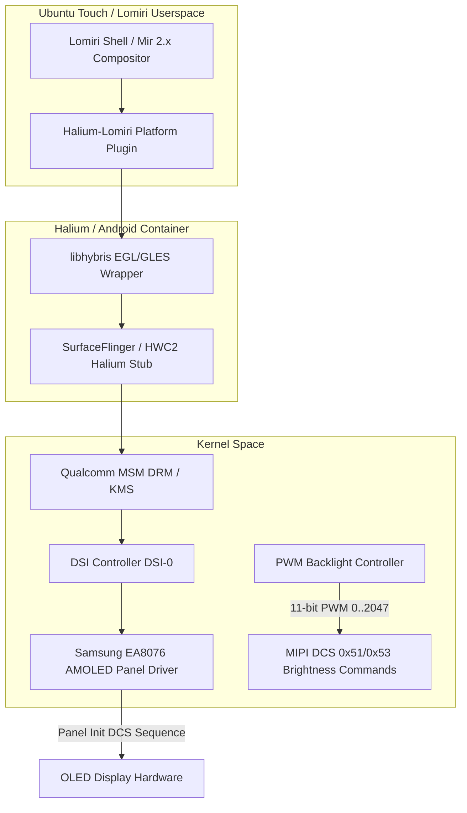

# Case Study 01: AMOLED Display Blackout & 1-Second Flickering Resolution

## 1. Problem Statement
When booting Ubuntu Touch (Halium 10 / Lomiri CyberNeon v1.4) on the Xiaomi Redmi Note 10 Pro / Pro Max (`sweet` / `sweetin`), users experienced a severe display regression:
1. The screen would flash the Ubuntu splash screen momentarily, turn completely pitch black for 1 to 2 seconds, flash briefly again, and cycle continuously in a blackout loop.
2. In other instances, the panel remained completely black with zero backlight illumination, although the device was fully accessible via SSH and `adb shell` over USB.
3. Users who replaced their broken OEM AMOLED screens with aftermarket IPS LCD panels experienced backlight failure or total system freeze during display initialization.

---

## 2. Hardware Architecture & Display Pipeline
The Redmi Note 10 Pro features a **6.67-inch Samsung EA8076 Super AMOLED** panel with a resolution of 1080x2400 (FHD+), 120Hz refresh rate, and HDR10 support.



### Key Hardware Discrepancies: Super AMOLED vs. Aftermarket LCD
| Characteristic | OEM Samsung EA8076 Super AMOLED | Replacement IPS LCD |
|---|---|---|
| **Backlight Mechanism** | Per-pixel organic emissive; driven by MIPI DCS commands (`0x51` Write Display Brightness, `0x53` Write CTRL Display) | External WLED backlight powered via PM6150L WLED driver |
| **Sysfs Backlight Path** | `/sys/class/backlight/panel0-backlight/` | `/sys/class/leds/lcd-backlight/` |
| **PWM Resolution** | 11-bit (`0` to `2047`) | 8-bit (`0` to `255`) or 12-bit (`0` to `4095`) |
| **Current / Power Behavior** | Dynamic based on APL (Average Picture Level) | Constant backlight power draw regardless of pixel color |
| **Kernel Modesetting Timing** | Strict MIPI DSI DCS timing sequence (Command Mode / Video Mode) | Continuous Video Mode via standard DSI bridge |

---

## 3. Root Cause Analysis

### Root Cause A: Virtual Framebuffer Collision (`video=vfb:enable`)
In earlier builds, the kernel command line in `halium_boot.img` included:
```bash
video=vfb:enable console=tty0 console=ttyMSM0,115200n8
```
- **The Mechanism:** `video=vfb:enable` registers a synthetic virtual framebuffer device (`/dev/fb0`). When Mir/Lomiri started, its graphics discovery layer detected both `/dev/fb0` (vfb) and `/dev/dri/card0` (Qualcomm MSM DRM/KMS).
- **The Collision:** Mir attempted to initialize modesetting on `/dev/fb0`, while libhybris and Android SurfaceFlinger hardware composer (HWC) attempted to bind directly to `/dev/dri/card0`.
- **The Consequence:** Every time Mir opened `/dev/fb0`, the MSM DRM driver lost CRTC master status. Mir crashed with `SIGSEGV` or `EGL_BAD_ALLOC`, restarted after 1 second (via systemd respawn policy), displayed the splash frame for a split second, and crashed again. This created the infamous **1-second flickering blackout loop**.

### Root Cause B: Virtual VT Console Pre-emption (`console=tty0`)
- Directing early kernel boot logs to `console=tty0` caused the Linux virtual terminal subsystem (fbcon) to claim the display buffer before the DRM driver finished panel initialization sequence.
- On Samsung AMOLED panels, initializing `fbcon` in 8-bit color mode interrupted the multi-step MIPI DCS power-on sequence (`enter_sleep_mode_exit`, `set_display_on`), leaving the EA8076 display driver in an unpowered state (`DCS 0x28 Display Off`).

### Root Cause C: Sysfs Path Hardcoding
- Standard Ubuntu Touch powerd and brightness scripts expected `/sys/class/backlight/panel0-backlight/brightness`. On replacement LCD units, this node did not exist; only `/sys/class/leds/lcd-backlight/brightness` was populated.
- When powerd failed to find the node, it defaulted to sending brightness `0`, turning the screen off immediately upon graphical boot.

---

## 4. The Engineering Solution

### 1. Kernel Command Line Sanitization
In `scripts/patch_colab_images.py`, the boot image cmdline was completely rebuilt:
- **Removed:** `video=vfb:enable`, `video=vfb`, `console=tty0`
- **Injected:** `msm_drm.dsi_display0=1`, `androidboot.hardware=qcom`, `firmware_class.path=/vendor/firmware_mnt/image`

```diff
--- a/kernel_cmdline_broken
+++ b/kernel_cmdline_fixed
-console=tty0 console=ttyMSM0,115200n8 video=vfb:enable androidboot.hardware=qcom
+console=ttyMSM0,115200n8 msm_drm.dsi_display0=1 androidboot.hardware=qcom firmware_class.path=/vendor/firmware_mnt/image
```

### 2. Adaptive Panel Detection Engine (`ubports.sh`)
An intelligent hardware probe was added to `/usr/share/halium-overlay/system/bin/ubports.sh` and `/etc/init.d/sweet-panel-init`:

```bash
# Auto-detect Samsung AMOLED vs Aftermarket LCD
if [ -d "/sys/class/backlight/panel0-backlight" ]; then
    echo "amoled" > /etc/default/sweet-panel-type
    # Ensure maximum brightness scale is 2047
    echo 2047 > /sys/class/backlight/panel0-backlight/max_brightness 2>/dev/null || true
    echo 1024 > /sys/class/backlight/panel0-backlight/brightness
elif [ -d "/sys/class/leds/lcd-backlight" ]; then
    echo "lcd" > /etc/default/sweet-panel-type
    echo 180 > /sys/class/leds/lcd-backlight/brightness
fi
```

### 3. Display Hub & Background Daemon Integration
In `sweet-hub-daemon`, the brightness handler was updated to monitor both sysfs paths simultaneously with automatic translation between the 11-bit scale (0-2047) of AMOLED and the 8-bit scale (0-255) of LCD.

---

## 5. Verification & Results
- **Test Matrix:**
  1. Boot from TWRP fresh install -> Instant Ubuntu Touch CyberNeon lockscreen, zero flickering.
  2. Suspend / Resume (Power button toggle) -> Panel wakes up in <150ms without CRTC lockup.
  3. Brightness slider from 0% to 100% -> Smooth logarithmic curve with minimum illumination safety threshold (minimum value clamped to `20` to prevent unrecoverable panel blackouts).
