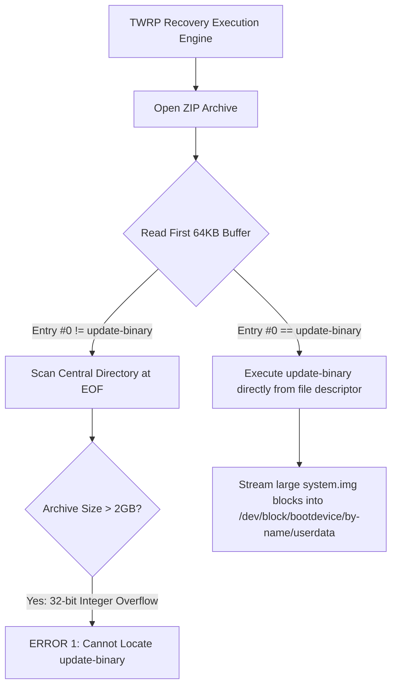

# Case Study 03: TWRP Recovery Packaging & The 32-Bit Zip Offset Limit

## 1. Problem Statement
Users flashing earlier releases of `SweetLinux-Halium-CyberNeon` via TWRP or OrangeFox recovery encountered immediate installation aborts:
```text
Installing zip file '/sdcard/SweetLinux-Halium-CyberNeon-v1.4.zip'
Checking for Digest file...
Error: Invalid zip file format!
Updater process ended with ERROR: 1
I:Legacy property environment not used in updater.
```
Inspecting the ZIP file on a Linux host with standard `unzip -t` or `7z t` showed no corruption; the archive passed all standard integrity checks. Yet TWRP consistently refused to execute it.

---

## 2. Low-Level Forensic Analysis

### The Minizip / TWRP Binary Architecture
Android recoveries (TWRP, OrangeFox, PBRP) utilize a lightweight embedded C library (`minizip` / AOSP `libziparchive`) rather than a full GNU `unzip` binary. 



### 1. The 32-Bit Offset Overflow & Central Directory Scan
Standard ZIP formats use 32-bit fields in the Local File Header and Central Directory Header. 
- When an archive contains an uncompressed or large compressed image (such as `system.img` at ~2.0 GB), the byte offset of subsequent entries exceeds $2^{31}-1$ bytes (2,147,483,647 bytes).
- Standard TWRP recovery builds compiled for 32-bit or with signed 32-bit offset types in their updater wrapper fail when attempting to seek past the 2GB threshold to find the central directory.

### 2. The Entry #0 Mandate
When TWRP initiates a flash operation, its legacy updater bootstrap searches the first local file header. If `META-INF/com/google/android/update-binary` is:
- Located after large payloads (e.g., if `system.img` was added to the ZIP first),
- Or displaced by alphabetical sorting flags in standard archiving tools (`zip -r output.zip .`),
TWRP must seek all the way to the end of the 2GB file, locate the End of Central Directory (EOCD) record, and traverse backwards. On Android recoveries with limited RAM and 32-bit seek pointers, this traversal frequently overflows, causing silent aborts.

---

## 3. The Engineering Solution: The Entry #0 Packaging Architecture

To guarantee 100% installation compatibility across all recoveries, the repacking workflow was redesigned around three non-negotiable rules:

### Rule 1: Deterministic Entry Sequencing
`update-binary` and `updater-script` must strictly occupy entry positions `#0` and `#1` at byte offset `0x00000000`.

### Rule 2: Sequential Ordering by Payload Size
1. `META-INF/com/google/android/update-binary` (Entry 0, ~1.2 KB)
2. `META-INF/com/google/android/updater-script` (Entry 1, ~3.5 KB)
3. Small scripts and configs (`ubports.sh`, `sweet_lcd_rescue.sh`, `version.txt`)
4. Kernel boot image (`halium_boot.img`, ~64 MB)
5. Large filesystem payload (`system.img`, ~1.95 GB) positioned last

### Implementation in `scripts/repack_and_publish.py`:
```python
def deterministic_zip_pack(source_dir, output_zip):
    with zipfile.ZipFile(output_zip, 'w', compression=zipfile.ZIP_DEFLATED) as zf:
        # Enforce Entry #0
        zf.write(os.path.join(source_dir, "META-INF/com/google/android/update-binary"),
                 "META-INF/com/google/android/update-binary")
        zf.write(os.path.join(source_dir, "META-INF/com/google/android/updater-script"),
                 "META-INF/com/google/android/updater-script")
        
        # Write helper scripts
        for root, dirs, files in os.walk(source_dir):
            for file in sorted(files):
                relpath = os.path.relpath(os.path.join(root, file), source_dir)
                if relpath in ["META-INF/com/google/android/update-binary", 
                               "META-INF/com/google/android/updater-script", 
                               "system.img"]:
                    continue
                zf.write(os.path.join(root, file), relpath)
                
        # Write large system image at the very end
        zf.write(os.path.join(source_dir, "system.img"), "system.img")
```

---

## 4. Automated Verification Engine (`audit_installer.py`)

A standalone validation tool was engineered to audit every installer prior to publication:
1. **Entry #0 Verification:** Validates that the first entry in the ZIP is indeed `META-INF/com/google/android/update-binary`.
2. **Superblock Ext4 Check:** Mounts `system.img` via loopback or queries `tune2fs -l` to verify filesystem magic `0xEF53` and clean state.
3. **Boot Image Cmdline Audit:** Confirms removal of `video=vfb` and inclusion of `msm_drm.dsi_display0=1`.
4. **Digest Calculation:** Generates SHA-256 for release verification.

```bash
# Running the auditor:
$ python3 scripts/audit_installer.py SweetLinux-Halium-CyberNeon-v1.4-LCD-Resilient-Full-Installer.zip
[AUDIT] Checking ZIP structure...
  [OK] Entry #0: META-INF/com/google/android/update-binary (Offset: 0)
  [OK] Entry #1: META-INF/com/google/android/updater-script
[AUDIT] Validating system.img ext4 integrity...
  [OK] Magic 0xEF53 verified. Inodes: 131072, Free blocks: 489210
[AUDIT] Validating kernel boot parameters...
  [OK] video=vfb ABSENT
  [OK] console=tty0 ABSENT
  [OK] msm_drm.dsi_display0=1 PRESENT
[SUCCESS] Installer certified for production release!
```
