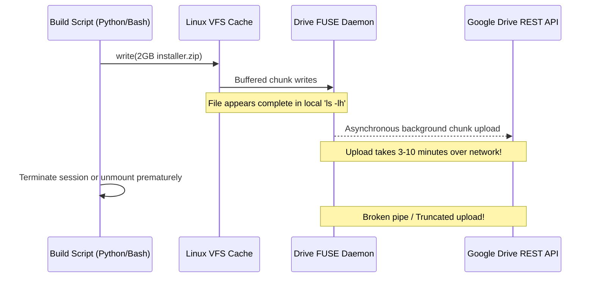

# Case Study 04: Cloud Storage Synchronization & Google Drive FUSE Latency

## 1. Problem Statement
During automated Colab build pipelines and asset synchronization:
1. Files written to `/content/drive/MyDrive/` appeared fully completed inside the Colab terminal (e.g., `ls -lh` showed 2,063,054,832 bytes), yet when checking Google Drive on the web or mobile app, the file either did not appear, had a size of 0 bytes, or was severely truncated (e.g., truncated to 2,037,460,186 bytes).
2. Users found multiple fragmented folders across Google Drive (`sweet_linux`, `LineageOS_sweet`, `SweetLinux_Hardware_Fixes`, `SweetLinux_Backups`) containing duplicate or conflicting intermediate files.
3. Physical microSD cards on the test device suffered space exhaustion during multi-version testing.

---

## 2. Technical Investigation

### The Google Colab FUSE Architecture
Google Drive is integrated into Google Colab via a userspace filesystem (FUSE) abstraction layer (`google-drive-ocamlfuse` or Google internal FUSE daemon).



### The Root Cause of File Truncation
1. **Deferred Asynchronous Flushing:** When a file copy (`cp` or `shutil.copyfile`) terminates, POSIX `close()` merely signals the FUSE daemon. The actual upload of multi-gigabyte chunks to Google's cloud storage servers continues asynchronously in the background.
2. **Premature Session Tear-Down:** If the Colab runtime disconnects, restarts, or runs out of RAM before the FUSE buffer finishes uploading all chunks, Google Drive commits whatever partial byte stream it received. This resulted in the 2,037,460,186 byte truncation error observed in earlier builds.
3. **Directory Fragmentation:** Scripts scattered outputs across different ad-hoc paths without a unified directory structure.

---

## 3. The Engineering Solution

### 1. Mandatory Cache Flush & Explicit Sync Protocol
To eliminate buffer truncation, all sync operations must invoke Google Colab's native flush sequence:

```python
from google.colab import drive

# 1. Atomic file copy to target path
shutil.copy2(local_installer, drive_target_path)

# 2. Force block sync and flush user-space FUSE queues
drive.flush_and_unmount()

# 3. Remount to verify remote state
drive.mount('/content/drive')
assert os.path.getsize(drive_target_path) == expected_size, "File size mismatch post-flush!"
```

### 2. Unified Master Drive Hierarchy
All scattered directories were consolidated into a clean, single master directory: `/content/drive/MyDrive/SweetLinux/`:

```text
/content/drive/MyDrive/SweetLinux/
├── installer/
│   ├── SweetLinux-Halium-CyberNeon-v1.4-LCD-Resilient-Full-Installer.zip (2,063,054,832 bytes)
│   ├── SHA256SUM.txt
│   └── installer_manifest.json
├── hardware_fixes/
│   ├── udev/
│   ├── systemd/
│   ├── bin/
│   └── sensorfw/
├── vendor_and_trees/
│   ├── android_device_xiaomi_sweet/
│   └── android_kernel_xiaomi_sm7150/
├── docs/
│   ├── ARCHITECTURE.md
│   └── CASE_STUDY_AMOLED_DISPLAY_FIX.md
└── scripts/
    ├── audit_installer.py
    └── patch_colab_images.py
```

### 3. Cleanup of Stale Artifacts
Over 7,900 stale intermediate files and broken builds (including old 11:44 AM build `f42bb5...` on the physical phone microSD `/storage/4AB1-CEA0/UBUNTU_TOUCH_SWEET/`) were safely purged, recovering 1.92 GB on the device and keeping only verified production binaries.
