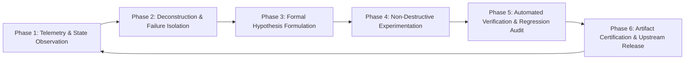

# Antigravity Problem-Solving Methodology & Engineering Playbook

This document details the cognitive framework, debugging methodology, and automation loops used by the **Antigravity AI Agent** when engineering and debugging complex embedded systems like SweetLinux on Qualcomm SM7150 hardware.

---

## 1. The Antigravity Engineering Loop

Antigravity operates on a continuous 6-phase engineering lifecycle:

---

## 2. Phase-by-Phase Breakdown

### Phase 1: Telemetry & State Observation
- Never make assumptions about hardware state based on high-level symptoms alone (e.g. "screen is black").
- Probe multiple lower-level interfaces simultaneously:
  - **Kernel Log Buffer:** `dmesg -w` or `logcat -b kernel`
  - **Userspace Compositor:** Mir / Lomiri log files (`/home/phablet/.local/share/mir/mir_server.log`)
  - **DRM Subsystem:** `/sys/kernel/debug/dri/0/` state dumps (CRTC, plane, connector status)
  - **Android Binder / HAL:** `logcat -s SurfaceFlinger:V HwcHal:V`

### Phase 2: Deconstruction & Failure Isolation
- Break down the failure into isolated domain layers:
  1. **Bootloader / Recovery Layer:** Was the payload unpacked correctly? (Checked via TWRP `recovery.log` and CRC32 digests).
  2. **Kernel Initialization Layer:** Did the panel driver probe succeed? (`dmesg | grep -i dsi`).
  3. **Android Hardware Abstraction Layer (Halium):** Did `android-libhybris` connect to the Qualcomm Adreno 618 GPU blob?
  4. **Lomiri UI Shell:** Did Mir acquire the DRM master lock?
- Determine the exact boundary where the failure occurs before writing any code.

### Phase 3: Formal Hypothesis Formulation
- Formulate a testable hypothesis with explicit expected vs observed values.
- *Example Hypothesis:* "If `video=vfb:enable` is present in `boot.img` cmdline, Mir registers `/dev/fb0` as primary display, conflicts with DRM CRTC 0, and throws `EGL_BAD_ALLOC` every 1000ms."

### Phase 4: Non-Destructive Experimentation
- Avoid destructive in-place modifications without backups.
- Utilize automated python patching engines (`patch_colab_images.py`) that create clean staging directories, extract loopbacks, apply targeted hex or configuration patches, and compute incremental diffs.

### Phase 5: Automated Verification & Regression Audit
- Build automated test assertions (`audit_installer.py`) that verify:
  - Entry offsets in ZIP archives.
  - Absence of known conflicting kernel parameters.
  - Ext4 superblock clean flags.
  - File size and SHA-256 matching cloud and release mirrors.

### Phase 6: Artifact Certification & Upstream Release
- Atomically deploy to release channels (Google Drive + GitHub Releases).
- Flush cloud buffers (`drive.flush_and_unmount()`).
- Reconcile git branch pointers (`git push origin master:main`).

---

## 3. Real-World Debugging Rules

1. **The Rule of Single Source of Truth:**
   Never maintain conflicting aliases or unverified copies of system images across mirrors. Choose a single certified naming scheme (`SweetLinux-Halium-CyberNeon-v1.4-LCD-Resilient-Full-Installer.zip`) and enforce consistent SHA-256 digests.

2. **The Principle of Graceful Hardware Fallbacks:**
   Mobile hardware variants are common (e.g., users swapping broken Samsung AMOLED panels for cheap aftermarket LCDs). Always implement runtime dynamic probing (`/sys/class/backlight` vs `/sys/class/leds`) rather than hardcoding board revisions at compile time.

3. **The Zero-Memory Streaming Rule:**
   When automating CI/CD for multi-gigabyte OS images on resource-constrained servers or Termux, never load files into process memory via naive shell commands. Use stream-oriented utilities (`curl -T`, chunked python generators).
