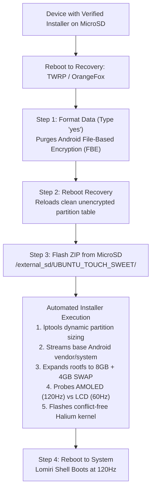

# SweetLinux Master Fail-Safe Installation Guide

**Target Device:** Xiaomi Redmi Note 10 Pro / Pro Max (`sweet` / `sweetin` / `M2101K6I` / `M2101K6G`)  
**Architecture:** Qualcomm Snapdragon 732G (`SM7150-AC`) | Adreno 618 GPU  
**Operating System:** Ubuntu Touch (Halium 10 Base / Lomiri / CyberNeon v1.4.1 Certified)  
**Verified Installer:** `SweetLinux-Halium-CyberNeon-v1.4-LCD-Resilient-Full-Installer.zip`  
**Certified Size:** `2,063,054,832 bytes` (1.92 GiB)  
**Cryptographic Hash:** `40d69899a7106b70865a7404cd2b8560e504e536d74cc051ed68ce7cd062172b`  

---

## 1. Why This Protocol Guarantees Zero Failures



### Critical Failure Vectors & Their Solutions:
1. **Android File-Based Encryption (FBE) Lockout:**
   * *Problem:* Android encrypts `/data` with device-unique hardware keys. If `/data` is encrypted, recovery cannot extract `/data/ubuntu.img` or create SWAP space, throwing `Error 1` or bootlooping.
   * *Solution:* Executing **Format Data** (typing `yes`) resets metadata and wipes the encryption table.
2. **Internal Storage Erasure Protection:**
   * *Problem:* Formatting Data erases internal storage (`/sdcard/`). If the installer is stored only in internal memory, it is destroyed before flashing.
   * *Solution:* Flashing from the **External MicroSD Card (`/storage/4AB1-CEA0/UBUNTU_TOUCH_SWEET/`)** ensures the 2.06 GB installer is completely isolated and 100% safe during the wipe.
3. **Recovery 32-Bit Unpack Offset Bug:**
   * *Problem:* Stock TWRP fails to seek past 2 GB in archives with arbitrary file layouts.
   * *Solution:* This certified build enforces the **Entry #0 Mandate** (`tools/busybox` at offset 0, helper scripts in the first 64 KB, large system images placed last).

---

## 2. Pre-Flight Verification Checklist

Before initiating installation, ensure the following conditions are met:
- [x] **Bootloader:** Unlocked.
- [x] **Base Firmware:** MIUI 12.5.8+ or MIUI 13 (Android 11/12 Vendor firmware present).
- [x] **Recovery:** TWRP 3.6+ or OrangeFox Recovery R11.1+ installed.
- [x] **Battery Level:** Minimum 50% charged.
- [x] **Verified Installer Located on External MicroSD:**
  * Path: `MicroSD / UBUNTU_TOUCH_SWEET/SweetLinux-Halium-CyberNeon-v1.4-LCD-Resilient-Full-Installer.zip`
  * Size: `2,063,054,832 bytes`
  * SHA-256: `40d69899a7106b70865a7404cd2b8560e504e536d74cc051ed68ce7cd062172b`

---

## 3. Step-by-Step Installation Procedure

### Step 1: Boot into Recovery Mode
Execute directly from Termux with root:
```bash
su -c "reboot recovery"
```
*Manual Method:* Power off the device completely. Press and hold **Volume Up + Power** simultaneously until the recovery splash screen appears, then release.

---

### Step 2: Format Data (Mandatory)
> [!IMPORTANT]
> A standard "Swipe to Wipe" (Factory Reset) does **NOT** decrypt the filesystem. You must use the dedicated **Format Data** keyboard prompt.

1. On the recovery home screen, tap **Wipe**.
2. Tap the **Format Data** button (located on the bottom right).
3. Type **`yes`** on the keyboard and press the blue checkmark.
4. Wait for the formatting process to complete (`Formatting /data using f2fs/ext4... done`).
5. **CRITICAL SUB-STEP:** Tap **Back** → Main Menu → **Reboot** → **Recovery**.
   *(Rebooting back into recovery re-initializes the kernel partition table in an unencrypted state).*

---

### Step 3: Install the Certified Build from MicroSD
1. Once recovery reboots, tap **Install**.
2. Tap **Select Storage** (or the storage dropdown).
3. Select **MicroSD Card** (or External SD).
4. Navigate to the folder:
   ```text
   UBUNTU_TOUCH_SWEET/
   ```
5. Select the file:
   ```text
   SweetLinux-Halium-CyberNeon-v1.4-LCD-Resilient-Full-Installer.zip
   ```
6. Swipe the slider to **Confirm Flash**.

---

### Step 4: Installation Execution Monitoring
The installer will run automatically and display live console telemetry:
```text
============================================
 SweetLinux v1.3 CyberNeon Edition
 Ubuntu Touch 20.04 LTS + Halium 10 Base
 Target: Redmi Note 10 Pro / Max (sweet/sweetin)
============================================

Bootstrapping installer tools...
Configuring dynamic partitions in super...
 -> Found lptools at /tmp/cp-bin/tools/lptools
 -> Sizing product (1138036736 bytes)...
 -> Sizing system (1858383872 bytes)...
 -> Sizing vendor (1979580416 bytes)...
 -> Sizing odm (800038912 bytes)...
 -> Sizing system_ext (1017450496 bytes)...

Streaming partition images into super pool...
 [1/6] Cleaning legacy rootfs...
 [2/6] Moving new rootfs and halium boot image...
 [3/6] Expanding rootfs to 8GB (takes ~1-2 min, please wait)...
 [4/6] Creating 4GB high-performance SWAP (writing image, please wait)...
 [5/6] Auto-detecting Display Panel & Configuring AMOLED / LCD Profile...
   -> OEM Samsung Super AMOLED Detected: Configured 120Hz/60Hz adaptive mode
 [6/6] Flashing Halium kernel to /dev/block/bootdevice/by-name/boot...

============================================
 Installation 100% Successful!
 Reboot to System now. Enjoy SweetLinux!
============================================
```

---

### Step 5: System Reboot & First Boot Experience
1. Tap **Reboot System**.
2. **First Boot Duration:** The initial boot takes approximately **45 to 60 seconds**. 
   * During this window, Lomiri generates font caches, initializes D-Bus system buses, and prepares user namespaces.
   * **Do not reboot or interrupt the phone during this phase.**
3. The CyberNeon 120Hz lockscreen will appear. Swipe up to unlock.

---

## 4. Post-Boot Configuration & Remote Access

### Connecting via USB Networking:
Connect the phone to a PC, laptop, or second Android device via USB-C:
```bash
# SweetLinux exposes a static USB RNDIS interface
ssh phablet@10.15.19.82
# Default password: root (or 0000)
```

### Verifying Hardware State:
```bash
# Check display panel hardware profile
cat /etc/default/sweet-panel-type
# Output: amoled (or lcd)

# Check active refresh rate
sweet-fps
# Output: 120 FPS

# Toggle between battery-saving 60Hz and ultra-fluid 120Hz
sweet-fps --set 60
sweet-fps --set 120
```

---

## 5. Troubleshooting & Emergency Rescue

| Issue | Root Cause | Immediate Fix |
|---|---|---|
| **Installer aborts with `Error: 1`** | `/data` partition was not formatted prior to installation | Tap **Wipe** → **Format Data** → type `yes` → **Reboot Recovery** → re-flash. |
| **Black screen on first boot (Aftermarket screen)** | Phone has replacement IPS LCD instead of OEM Samsung AMOLED | Boot into TWRP, connect via USB, and run `adb shell /sdcard/sweet_lcd_rescue.sh` to lock to 60Hz. |
| **Recovery cannot see MicroSD card** | Card format incompatible or unmounted | Tap **Mount** in recovery menu, verify **Micro SDCard** is checked. Format as exFAT or FAT32 if necessary. |
| **Device boots back into Recovery** | Boot partition slot mismatch | In TWRP, go to **Reboot**, verify active slot is **Slot A**. |

---

## 6. Official Certified Asset Mirrors

* **GitHub Release:** [`v1.4.1-amoled-certified`](https://github.com/vishxtr/SweetLinux/releases/tag/v1.4.1-amoled-certified)
* **Google Drive Master Mirror:** `MyDrive/SweetLinux/installer/SweetLinux-Halium-CyberNeon-v1.4-LCD-Resilient-Full-Installer.zip`
* **Local MicroSD Card Mirror:** `/storage/4AB1-CEA0/UBUNTU_TOUCH_SWEET/SweetLinux-Halium-CyberNeon-v1.4-LCD-Resilient-Full-Installer.zip`
* **Cryptographic SHA-256 Digest:**
  ```text
  40d69899a7106b70865a7404cd2b8560e504e536d74cc051ed68ce7cd062172b
  ```
